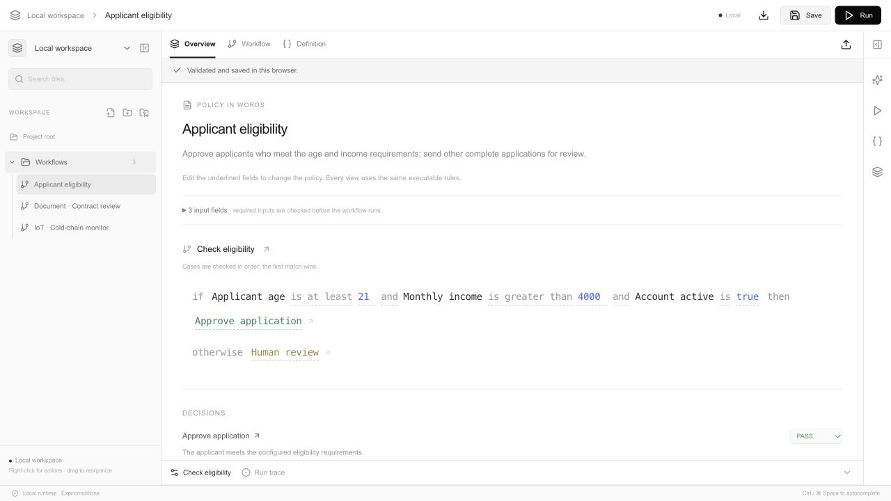
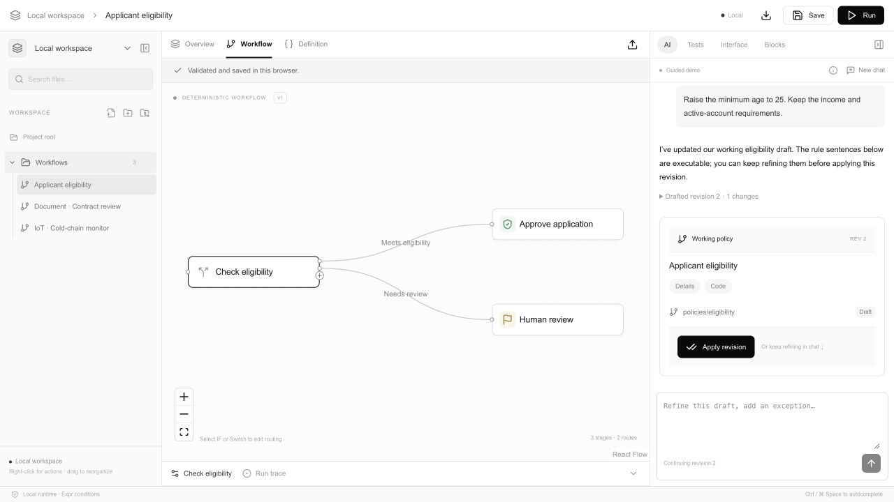
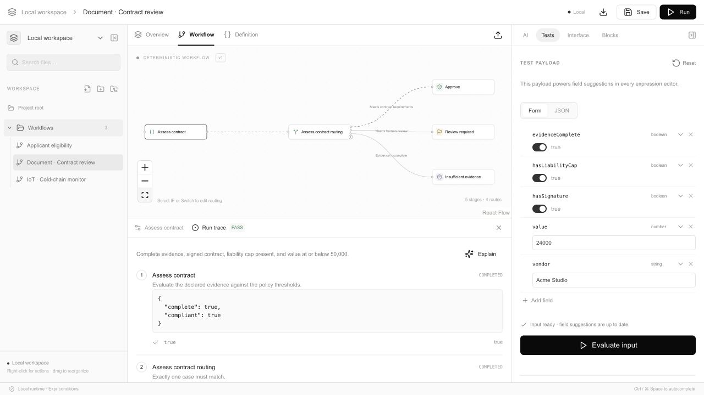

<div align="center">

# Rulesmith

**Write policies in words. Shape them into workflows. Explain every decision.**

A local policy studio with conversational AI authoring, a visual editor, and a deterministic Go runtime.

Next.js · React Flow · Tailwind · Go · Expr · QuickJS

[Quick start](#quick-start) · [Product tour](#product-tour) · [Examples](#examples) · [Technical guide](docs/guide.md)

</div>



Rulesmith brings the policy, its workflow, and its execution record into one workspace. Edit an underlined rule in plain language, inspect the same rule on the graph, then run it against JSON and see how the decision was reached. Definitions stay portable: the canvas is a view of your policy, not its file format.

**No database or API key required to get started.** A guided assistant demo works out of the box; configure an AI provider for open-ended authoring.

## Quick start

Requires **Go 1.24+**, **Node.js 20.9+**, npm, and Make.

Run these commands from the repository root, the directory containing `Makefile`:

```sh
make install
```

Start the backend and frontend in two terminals:

```sh
# Terminal 1 — Go API
make api
```

```sh
# Terminal 2 — web studio
make web
```

Open [127.0.0.1:3000](http://127.0.0.1:3000). The API runs at `127.0.0.1:8080`.

Start with **Document · Contract review** and click **Run**. In **Tests**, turn `hasSignature` off for a review decision, or `evidenceComplete` off for insufficient evidence. The form and JSON views edit the same payload.

## Product tour

### A policy you can read and edit

**Overview** presents the whole workflow as executable prose. Change underlined fields, operators, values, and destinations directly. Those edits update the graph, portable JSON, and runtime behavior together. Complex expressions remain available in the expression editor.

The left explorer organizes projects, nested folders, and workflow files. Each file keeps its own draft, tests, and conversation. Right-click to rename or move items; drag to reorganize; recover deleted items from Trash.

### A conversation that evolves the same draft



Describe a policy, refine a threshold, add a requirement, and review the proposed revision before applying it. The assistant retains conversation context and a working draft. It can also execute policies, explain saved decisions, and replay the original policy and input.

Try this in the **AI** tab:

1. “Create an applicant eligibility policy.”
2. “At least 21 years old, monthly income over 4000, and an active account.”
3. “Raise the minimum age to 25. Keep the other requirements.”
4. Review the revision, **Apply revision**, then run a test.

Screenshots show the built-in **guided demo**, which supports selected examples without an API key. Connect an OpenAI-compatible provider for broader conversations; generated definitions still pass validation before review.

### Follow the workflow and the evidence



Build horizontal flows using **Evaluation**, **IF**, **Switch**, **Code**, and **Decision** blocks. Conditions live inside routing blocks; arrows show readable case labels. The **+** connector adds a branch, including a choice of block when dropped onto empty canvas. Existing connections stay attached.

The right sidebar switches between **AI**, **Tests**, **Interface**, and **Blocks**. The bottom dock holds the selected block’s editor or the latest **Run trace**. Traces expose visited stages, typed outputs, evaluated conditions, explanations, and the final outcome. Field completion draws from the current test payload and available ancestor outputs.

| Outcome | Meaning |
| --- | --- |
| **PASS** | The policy explicitly approves. |
| **REJECT** | The policy explicitly rejects. |
| **FLAG** | The policy requests human review. |
| **UNKNOWN** | Required evidence is missing, or no route can decide. |
| **EXECUTION_ERROR** | A type, expression, output contract, or runtime failure prevented evaluation. |

Save regression cases with expected outcomes and run them together. Chat commands such as `/run`, `/runs FLAG`, `/audit`, and `/replay` make the same execution history available in conversation.

## Examples

| Example | What it demonstrates |
| --- | --- |
| [Contract review](examples/contract.json) | Structured evidence, value thresholds, approval, review, and insufficient evidence. |
| [Cold-chain monitor](examples/iot.json) | Temperature and freshness checks on supplied sensor data. |
| [Applicant eligibility](examples/eligibility.json) | Editable rule sentences, eligibility thresholds, and fallback review. |
| [IF routing](examples/if.json) | A single amount check with True/False destinations. |
| [Order total in JavaScript](examples/javascript.json) | Filtering line items, calculating a discount, and returning typed outputs. |

The studio includes the first three examples. Import the others using **Import policy JSON**; matching `*-input.json` fixtures are in [examples](examples).

## Add an AI provider

Export the following in the terminal that starts the Go API:

```sh
export AI_API_KEY='your-key'
export AI_BASE_URL='https://api.openai.com/v1'
export AI_MODEL='your-model-name'
make api
```

Use an OpenAI-compatible Chat Completions provider with JSON-object response support. The base URL is the API root; Rulesmith appends `/chat/completions`. Keys stay in the backend process. The provider receives the current policy, pending draft, conversation, test input, and relevant run context.

See [.env.example](.env.example) for configuration. The server does **not** automatically load `.env`; export variables before starting it. Provider failures are surfaced explicitly. AI helps author and explain policies; it does not decide the result of Expr execution.

## Run without the editor

```sh
go run ./cmd/policy validate -policy examples/contract.json
go run ./cmd/policy run \
  -policy examples/contract.json \
  -input examples/contract-input.json
```

The CLI returns JSON with the outcome, explanation, and full trace. All completed policy decisions, including **REJECT**, return exit code `0`; inspect `outcome`. Command errors return `1`, execution errors return `2`.

Embed [pkg/workflow](pkg/workflow) in a Go application using `workflow.Validate` and `workflow.Run`. Expr-only workflows run locally without React, HTTP, or an AI provider.

### How it fits together

```text
Policy in words ─┐
Visual workflow ─┼─→ Portable workflow JSON ─→ Go / Expr runtime ─→ Outcome + trace
JSON definition ─┘            ↑
                      Reviewed AI drafts
```

The definition owns typed inputs, outputs, stages, cases, and connections. React Flow positions are presentation state. The runtime traverses a deterministic DAG along one selected path; this MVP does not implement parallel execution or joins.

**Code blocks** run JavaScript in a fresh QuickJS WebAssembly VM inside a disposable browser worker. They have no DOM, network, storage, or host API access, and enforce time, memory, and JSON boundary limits. Code workflows use browser-assisted execution; the standard Go CLI fails closed at a Code stage unless an embedder supplies an executor. See [the sandbox and trust model](docs/guide.md#security-boundary-and-limits) before using that mode for enforcement.

## Development

```sh
make test   # Go race checks, TypeScript, frontend and sandbox tests
make build  # bin/policy and the production web build
```

To run the production web build, use `cd web && npm start` with the Go API still running.

| Directory | Purpose |
| --- | --- |
| [web](web) | Next.js studio, React Flow canvas, rule editors, and browser sandbox. |
| [pkg/workflow](pkg/workflow) | Reusable workflow model, validation, and execution engine. |
| [internal/studio](internal/studio) | HTTP API, AI adapter, and browser execution protocol. |
| [cmd/policy](cmd/policy) | CLI and API entry point. |
| [examples](examples) | Portable sample definitions and test inputs. |

[Read the technical guide](docs/guide.md) for schema semantics, HTTP endpoints, assistant commands, sandbox limits, and detailed editor behavior.

## MVP scope

Workspace files, chats, saved tests, and recent runs persist in **this browser**. Export workflow JSON to move a definition between environments. Local run history is for inspection and replay; it is not a tamper-resistant audit system.

The API binds to loopback and has no authentication or multi-user storage. Contract examples evaluate structured evidence rather than extracting PDFs; IoT examples evaluate JSON rather than connecting to devices. The project is intended for local authoring and evaluation, with production collaboration and external adapters left for future work.
